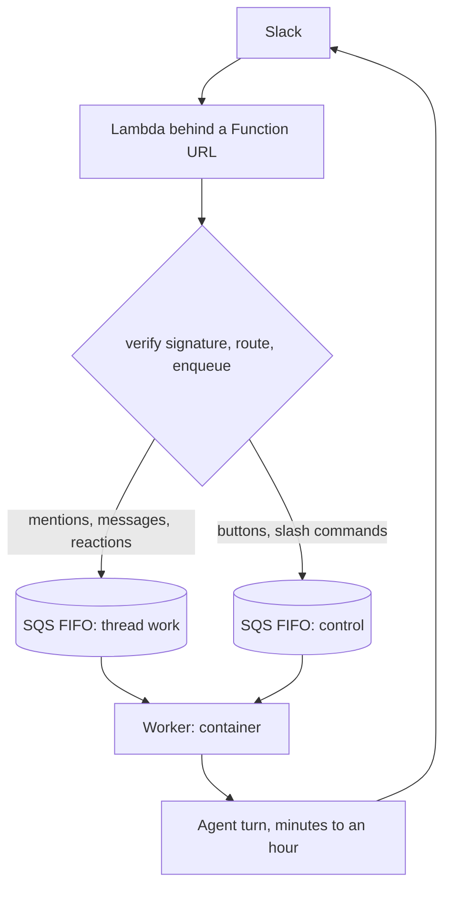

# 💚 How to build a serverless AI agent that lives in Slack

You want an AI agent that lives in Slack: someone mentions it, it does real work, it answers. The work is slow. It queries a warehouse, runs code, opens a pull request. A turn can take an hour.
This guide covers the architecture that makes that possible on AWS, what to configure, and the failure modes that are not obvious until production. It assumes you are comfortable with Lambda, SQS and a container runtime, and that you have built webhook receivers before.
The design is not Slack-specific. It applies to any provider that sends you a synchronous webhook and expects a fast response while the work it triggers is slow: Stripe, GitHub, Twilio, Shopify.
## The constraint you are designing around
Slack requires a 200 response within three seconds and retries the delivery if it does not get one. Your agent turn runs for minutes.
**You cannot reconcile these in one process.** The component that acknowledges the webhook must be separate from the component that does the work, with durable storage between them.
Everything below follows from that sentence. If you only take one thing from this guide, take that one, because it is the decision people get wrong and then spend weeks working around.
## The architecture

Three moving parts. A function at the edge, two queues, a container doing the work.
## Step 1: Put a Lambda at the door
Create a Lambda behind a Function URL. Give it exactly four responsibilities: verify the signature, decide which queue, enqueue, return 200.
Nothing else belongs in it. No business logic, no database, no model calls.
**Configuration to start from:**
**Ship it with zero dependencies.** Target a deployment artifact under 50 KB, standard library only. This is the single highest-value constraint in the whole build. A cold start that imports a large dependency tree can consume the three-second budget before your handler runs, and the resulting retries are very hard to attribute to the real cause. Add a build-time check that fails if anything imports your application package.
**Verify on the raw body bytes.** Compute the HMAC over the bytes exactly as received. If you parse JSON and re-serialise before hashing, whitespace and key order change and the signature will never match. Function URLs also deliver the body base64 encoded, so decode first, then verify the decoded bytes.
**Order the handler as verify, enqueue, respond.** Never return 200 before the enqueue is confirmed, or a transient queue failure becomes silent data loss. On enqueue failure return 500 and let the provider retry.
**On the public URL:** `AuthType=NONE` sounds wrong until you work it through. Slack cannot sign with SigV4, so IAM auth is not available. A shared bearer token is just a second credential to manage and leak. The HMAC signature is already a cryptographic auth boundary with a replay window. Use it, reject anything older than five minutes, and log the rejection reason without logging the body.
**Accept several signing secrets.** Read the secret as a comma-separated list and accept a request that matches any of them. You will need this the first time you run two apps against one endpoint, during a migration or while testing, and retrofitting it under time pressure is unpleasant.
## Step 2: Put SQS FIFO in the middle
This is where the design earns its keep.
**Set **`MessageGroupId`** to the conversation identifier.** For Slack that is `channel:thread_ts`. You immediately get strict ordering with one message in flight within a conversation, and unconstrained parallelism across conversations.
That is a distributed lock you did not have to write, and it is what lets you run any number of workers. If your current system has a concurrency ceiling, check whether it is a resource limit or an in-process lock. Usually it is the lock.
**Set **`MessageDeduplicationId`** from the provider's own event id.** Not content-based deduplication: two identical messages in a conversation are legitimately two messages. Turn `ContentBasedDeduplication` off and set the id explicitly.
**Know the limit.** FIFO deduplication covers a five-minute window and only that queue. A retry arriving later, or a redelivery after a worker crash, is not covered. If duplicate work is expensive, add a durable table keyed on the same id and check it in the worker.
**Starting configuration:**
## Step 3: Use two queues, not one
Split interactive events, meaning button presses and slash commands, onto a separate queue from conversation work.
If they share a queue, a cancel action enqueues behind the job it is trying to cancel and inherits its latency. A cancel that takes an hour is not a cancel.
**Group the control queue differently.** Group it by the originating message or by user, never by conversation. Grouping by conversation reproduces the exact problem inside the second queue, which is a frustrating bug to find because the architecture looks right.
## Step 4: Run the work in a container
The worker is a container, not a function. An hour-long job does not fit a function execution model, and forcing it leads to artificial work splitting that complicates failure handling for no benefit.
This is the step most serverless guidance skips. The question is not whether to adopt serverless, it is which components have a shape that suits it. An ingress that is small, spiky and latency-bound suits a function. A worker that is long-running and stateful within a job does not.
**The critical detail: delete the message after you accept the work, not after you finish it.**
The lifecycle should be: receive, write a durable record of the job, delete the message, then do the work. Milliseconds, not minutes.
Holding the message for the duration of the job is the most common mistake in this design and it is specific to FIFO. A FIFO group suppresses every later message while one is in flight. Hold a message for an hour and you have blocked the entire conversation, including the follow-up asking it to stop. Crash recovery comes from your durable record, not from queue redelivery.
If you must hold a message longer than the visibility timeout, extend it on a heartbeat with `ChangeMessageVisibility` rather than setting a large static timeout. A static timeout sized for your worst case also means a crashed worker's message is invisible for that whole duration.
## Step 5: Instrument the edge without paying for it
You want metrics from the Lambda, but an SDK call adds a network round trip to a path with a three-second budget.
Use CloudWatch Embedded Metric Format. Write structured JSON to stdout and CloudWatch extracts metrics from the log stream. No added latency, no extra call.
**Publish a low-cardinality dimension set alongside your detailed one.** If a metric only exists at full dimensionality, every alarm needs metric math across dimension combinations, and in practice that means the alarms never get built.
Metrics worth emitting from the ingress: enqueued, rejected with reason, enqueue failed, misconfigured, and a counter for provider retries.
## Failure modes to design for before they happen
The first row generalises furthest. **A queue is a delivery mechanism, not a progress tracker.** Once work is accepted it belongs in a database and the message should be gone. Using message visibility as job state couples your queue semantics to your job duration, and FIFO makes that coupling expensive.
## Decisions this guide does not make for you
**Scale to zero.** This architecture permits it: the ingress is already serverless and the workers are queue-driven, so queue-depth autoscaling is a natural next step. But it is work, and whether it pays depends on your traffic shape and whether your worker image is large enough that cold starts hurt. Do not quote a cost model that assumes it until it is running.
**Where the worker runs.** Kubernetes, ECS, Fargate and plain instances all work. The architecture does not care. Cold start cost does: a platform that re-pulls your image on every start changes the autoscaling maths considerably.
**How much state lives in the queue.** This guide pushes state into a database early and keeps the queue dumb. That is the right default. If your jobs are short and idempotent you can keep more in the queue and simplify.
## Minimum checklist before you call it done
- Signature verified over raw bytes, before any parsing
- 200 returned only after a confirmed enqueue
- `MessageGroupId` set to the conversation, `MessageDeduplicationId` to the provider's event id
- Separate queue for interactive events, grouped by something other than conversation
- Dead letter queue on both queues, with an alarm, with a subscriber
- Message deleted on admission, with a durable record written first
- Visibility extended by heartbeat if the worker holds anything
- One test exercising real provider configuration, not only internal consistency
- Worker logs shipped off the node
This design is running in production handling several thousand Slack deliveries a week. Most of the implementation was done by two engineers with no prior infrastructure background. The queue semantics in steps 2 to 4 were the hardest part, and they are the part worth reading twice.
