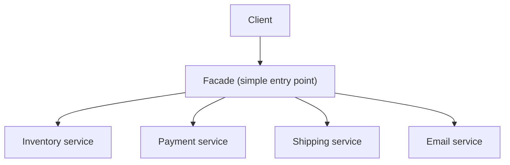

# 💚 Facade Pattern

## 💛 What is it?
The **Facade pattern** puts a **simple, unified interface** in front of a complex subsystem. The client calls one easy method, and the facade coordinates the many classes behind it.
Plain version: you have a tangle of classes that must be used together in a specific order. A facade is one **front-desk object** that exposes a few simple methods and does the orchestration for you. Like a hotel front desk: you ask for a wake-up call, and the desk quietly deals with the phone system, housekeeping, and scheduling on your behalf.
## 💛 Why do we need it?
- **Tame complexity.** A subsystem has many classes with fiddly setup and ordering. A facade gives callers one entry point so they do not have to learn all of it.
- **Decouple callers from internals.** The client depends on the facade, not on the dozen inner classes, so you can refactor the internals without breaking callers.
- **Offer a sensible default path.** The facade covers the common case simply, while power users can still reach into the subsystem directly when they need to.
### 🤍 Real-world use case
Placing an order really means: reserve inventory, charge the card, schedule shipping, and send a confirmation email, in that order. Instead of making every caller orchestrate four services, you expose one `place_order()` facade that runs the whole dance.
## 💛 How it works
- **Facade**: the single entry-point class with a few high-level methods.
- **Subsystem classes**: the many lower-level classes that do the real work.
- The **client** talks only to the facade; the facade delegates to and orders the subsystem.
### 🤍 Structure

### 🤍 Example (Python): an order facade
```python
class OrderFacade:
    def __init__(self, inventory, payment, shipping, email):
        self._inventory = inventory
        self._payment = payment
        self._shipping = shipping
        self._email = email

    def place_order(self, user, cart):
        self._inventory.reserve(cart)
        charge = self._payment.charge(user, cart.total)
        shipment = self._shipping.schedule(user.address, cart)
        self._email.send_confirmation(user, charge, shipment)
        return shipment.tracking_id

# Client: one call, no knowledge of the four services or their order
tracking = OrderFacade(inv, pay, ship, mail).place_order(user, cart)
```
The caller never touches inventory, payment, shipping, or email directly, and never has to get the ordering right.
## 💛 Facade vs its neighbors
These look alike but solve different problems:
- **Facade**: build a new, simpler interface over a whole subsystem of many classes. The goal is simplification.
- **Adapter**: convert **one** existing interface into another that the client already expects. The goal is compatibility, not simplification (see the Adapter note).
- **Mediator**: centralize how a set of objects talk to **each other**. That is bidirectional; a facade is one-way (client to subsystem).
- **Proxy and Decorator**: keep the **same** interface as the thing they wrap. A facade deliberately introduces a new, simpler one.
## 💛 Where you have already seen it
- An SDK client (a `boto3` client is a facade over many raw AWS API calls).
- A service-layer method that orchestrates several repositories behind one call.
- A compiler driver that hides the lexer, parser, and code generator behind `compile()`.
## 💛 Gotcha
- **Do not let it become a god object.** If the facade accumulates every method under the sun, it turns into a bloated catch-all. Keep it to the common high-level operations and split facades by concern.
- **Keep domain logic in the subsystem.** The facade should orchestrate, not grow its own business rules. Logic that lives only in the facade is hard to find and reuse.
- **A facade is convenience, not a wall.** The subsystem stays directly usable for advanced needs. If you actually need to forbid direct access, that is a module-boundary concern, not what a facade gives you.
- **Hiding complexity can hide cost.** One tidy `place_order()` call might fire four network requests. Callers may not feel the weight, so document the side effects and failure modes.
## 💛 References
- Refactoring Guru: Facade: https://refactoring.guru/design-patterns/facade
- SourceMaking: Facade: https://sourcemaking.com/design_patterns/facade
- Gang of Four, Design Patterns (the original catalog)
